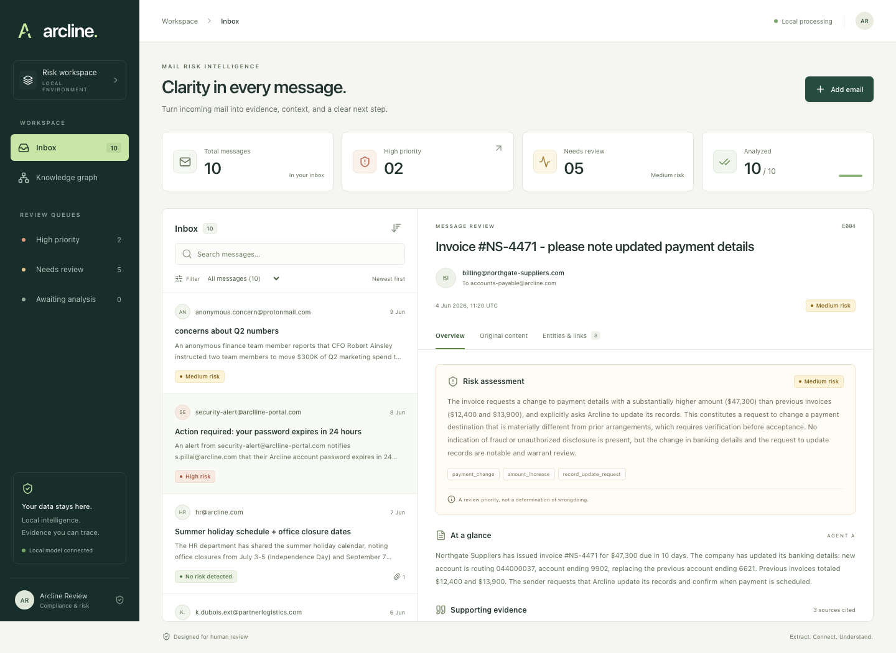
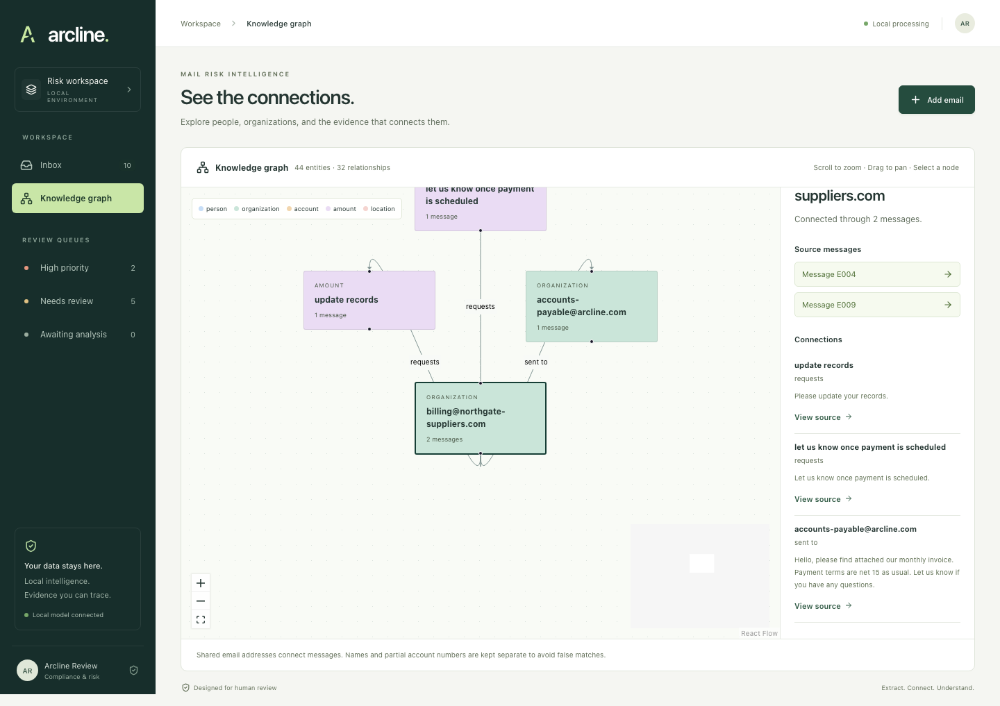

# Arcline · Mail Risk Intelligence

A local-first review workspace that turns incoming emails into structured facts, risk assessments and an evidence-linked entity graph. Built for the full-stack/pipeline take-home assignment. The ten provided messages go through the same real LLM pipeline as newly added messages. No paid API key or cloud service is required.

## Run it

**Requirements:** Node.js **24.12 or newer**, npm, and [Ollama](https://ollama.com/download) for actual analysis. Apple Silicon with 16 GB RAM was used during development. The default model, `qwen3:4b-instruct`, downloads roughly 2.5 GB; speed varies by machine.

```sh
npm ci
cp .env.example .env
```

Start the model server in a terminal:

```sh
npm run model:serve
```

In another terminal, download the model once and run the app:

```sh
npm run model:pull
npm run dev
```

Open **http://localhost:5173**. The API runs on port 3001. Ten messages are seeded on first launch and processed serially; each appears immediately, with live stage updates. The first model call may take longer while the model loads. Leave the app running while the inbox is analyzed.

The model scripts keep downloaded weights under `work/models/` **inside the project**, outside iCloud if you clone to a non-synced location. If Ollama is already running with a model you downloaded elsewhere, you can instead use that server directly (`ollama pull qwen3:4b-instruct`) and skip `model:serve`. Do not run two Ollama servers on the same port. A project-local CLI at `work/runtime/ollama` is supported for development, but is not included in Git.

For a production build served by Express:

```sh
npm run build
npm start
```

Open **http://localhost:3001**. No deployment, authentication or cloud provisioning is needed. Both development and production servers bind to loopback; this submission is a local application, not an internet-facing service.

### Without a running model

The UI and storage still work. Original messages remain available, and uploads are accepted. Model failures have an explicit status and **no risk level**. There are no canned or rule-based “LLM results.” Fix the model connection and use **Retry failed stage**. If extraction succeeded, only assessment is retried.

To explore the UI without making model calls, set `AUTO_PROCESS=false` in `.env` before starting. Items remain queued until **Start analysis** is selected. Previously completed results remain visible with the model offline. A new clone has no precomputed assessments; running the actual model is necessary to populate them.

### Configuration

| Variable          | Default                  | Purpose                                           |
| ----------------- | ------------------------ | ------------------------------------------------- |
| `PORT`            | `3001`                   | API / production UI port; Vite proxy follows PORT |
| `OLLAMA_BASE_URL` | `http://localhost:11434` | Ollama API server                                 |
| `OLLAMA_MODEL`    | `qwen3:4b-instruct`      | Local model used by both agents                   |
| `LLM_TIMEOUT_MS`  | `60000`                  | Per-call timeout; increase for slow hardware      |
| `DATABASE_PATH`   | `./data/mailbox.sqlite`  | Persistent SQLite database                        |
| `AUTO_PROCESS`    | `true`                   | Automatically enqueue new and waiting items       |

`npm run dev` uses Vite on 5173 and Express on 3001. The Vite proxy reads `PORT` from the environment or `.env`; restart development servers after changing it. Ollama must support `/api/chat`, JSON-schema output and `think: false` (the default Qwen3 model does). Model credentials are not used. Data files, model downloads, `.env`, logs and browser artifacts are ignored by Git.

### Local addresses and portability

`localhost` always refers to the computer running the browser or process, not a particular developer's machine. The frontend calls relative `/api` URLs, so requests follow the origin serving the app. During development Vite proxies those calls to `http://localhost:${PORT}` (3001 by default); in the production build Express serves both the UI and API on the same origin. Ollama uses `http://localhost:11434` by default and can be configured with `OLLAMA_BASE_URL`. Project and database paths are relative; no personal computer name or user directory is required.

## Product walkthrough

- **Inbox:** newest-first list with sender, subject, date, risk/status badge, attachment count, search, risk filters and risk sorting.
- **Overview:** risk rationale, tags, summary and expandable extracted facts with exact source quotes. Allegations are described as claims, not verified wrongdoing.
- **Original content:** decoded email text and available attachment text; untrusted HTML is converted to inert text and links are never fetched.
- **Entities & links:** typed entities and directed relationships, each with evidence.
- **Add email:** paste plain/raw email text or upload TXT, PDF or EML. Processing is asynchronous and does not block browsing.
- **Knowledge graph:** aggregate network with pan, zoom, keyboard-focusable nodes, an entity search/list, source-message navigation and a connections inspector.
- **Mobile:** an inbox/detail flow with a back button and dedicated inbox/graph navigation.

## Architecture

```text
React UI → Express API → ingestion → SQLite (queued)
                                    ↓
                              serial worker
                                    ↓
                  Agent A → schema + source validation
                                    ↓
                       persist successful extraction
                                    ↓
                  Agent B → schema + graph validation
                                    ↓
                    atomic assessment + graph writes
```

```text
shared/contracts.ts       Zod contracts and shared client types
server/ingestion/         MIME / text / PDF normalization and limits
server/agents/            Prompts, Ollama adapter, retries and validation
server/pipeline.ts        Sequential orchestration and resume semantics
server/storage/          SQLite repository, entity identities and graph
server/app.ts             API and HTTP error handling
server/index.ts           Configuration, seed, recovery and startup
client/                   Inbox, review UI, upload dialog and graph
scripts/model.mjs         Optional project-local model storage helper
scripts/evaluate.ts       Reproducible real-model seed smoke run
```

### The two agents

**A — Extraction:** receives deterministic envelope metadata plus labeled sources (`headers`, `body`, attachment filenames). Returns metadata, summary, typed facts, links and attachment summaries. Facts include attribution and source quotes, preserving requests, deadlines, account changes, links, threats and other context B needs.

**B — Risk & Graph:** receives **only A's validated structured output**. Returns `none/low/medium/high`, rationale, tags, evidence, typed entities and directed relationships. It has no access to the rest of the mailbox. Risk is a review priority, not a fraud verdict.

Both are real, separate calls to the same configurable local LLM. A schema is sent both as an Ollama output constraint and in the prompt so the model sees field descriptions. No agent framework is needed for this two-stage dependency. Prompts are versioned in source; the extraction model and prompt version are stored with A's result. A separate per-attempt audit history for B is a future extension.

### Validation and failure behavior

- Enforce Zod schemas for both outputs; reject invalid JSON, missing fields, oversized output collections, ambiguous entity IDs and dangling relationship endpoints. Identical repeated mentions (same ID, type, name and identifier) are safely collapsed; conflicting reused IDs still fail.
- Check A's quotes against the original sources. If a quote is exact but its source label is wrong, correct the label **only if the quote occurs in exactly one source**. If only whitespace/line wrapping differs, accept only one unambiguous match across the supplied sources and restore that exact original substring. Changes to words or punctuation remain invalid; stored quotes always use original text.
- B returns zero-based fact indexes rather than copying quotes. The server validates index bounds and resolves the references to A's original source/quote pairs. This checks provenance, **not semantic truth or whether every inference is supported**; human review remains essential.
- Require evidence-backed facts from the body and every readable attachment, so an attachment-only extraction cannot silently omit the email narrative. Append a deterministic sender-header fact when the model omits it.
- Known envelope headers take precedence over model-generated metadata. Missing values remain null where appropriate.
- A failed/unfinished analysis has a null risk level, never `none`.
- A timeout/network failure, HTTP 429 or HTTP 5xx gets at most two retries with 1s/2s backoff. Missing models/configuration errors fail immediately.
- Invalid output gets one repair attempt with the prior response and validation errors. If it still fails, show a retryable failed stage. Each generation can itself encounter transient retries; the worst-case stage duration is bounded by six model calls plus backoff.
- Save A before calling B. Retrying B does not repeat A.
- Recover interrupted `extracting`/`assessing` items to `queued` at startup. Failed items wait for user retry. Completed items are not automatically reprocessed.
- A single serial worker limits pressure on local hardware. A queued database row survives restart; the in-process scheduler is intentionally single-server.

### Storage and identity

SQLite stores normalized message content, warnings, status, extraction, assessment, failure details and extraction model/prompt provenance. Separate `entities`, `mentions` and `relationships` tables retain per-message evidence. Assessment and graph writes are transactional. Foreign keys and endpoint validation prevent dangling links.

Only **exact email identifiers** are merged across messages (case-normalized as a documented pragmatic assumption). Names, organization names and partial account numbers stay scoped to their message to avoid false merges. Full account identifiers are represented but are also kept message-scoped in this version. The graph may therefore contain visually similar nodes; this is preferable to inventing identity equivalence. No employee identity is inferred solely from a domain.

### Ingestion boundaries

- One file per upload, maximum **5 MB**; maximum **12,000 readable characters** per item including attachment text and metadata. Oversized content is rejected, not silently truncated.
- UTF-8 TXT, text-based PDF, and MIME EML. EML reads plain text or converts HTML to text, plus TXT/PDF attachments (up to 10).
- Scanned/empty or encrypted/damaged PDFs receive a clear error. OCR, nested EML, images and office formats are outside scope.
- Unreadable/unsupported attachments yield a prominent **partial analysis** warning while readable content is retained. If no content is readable, ingestion fails.
- Seed attachments already contain extracted text; they enter the same normalized pipeline as parsed uploads.
- Original decoded text and envelope fields are stored; original binary files and full MIME transport headers are not retained. There is no attachment download or automatic remote fetch.

### API

| Method / route               | Behavior                                                |
| ---------------------------- | ------------------------------------------------------- |
| `GET /api/health`            | Model readiness and queue state                         |
| `GET /api/emails`            | Inbox summaries; risk is nullable                       |
| `GET /api/emails/:id`        | Original normalized content and all stage results       |
| `POST /api/emails`           | JSON `{ "text": "..." }`; returns 202 and ID            |
| `POST /api/uploads`          | Multipart field `file`; returns 202 and ID              |
| `POST /api/emails/:id/retry` | Start queued or retry failed item; 409 otherwise        |
| `GET /api/graph`             | Aggregated nodes, evidence-linked edges and message IDs |

Errors use `{ "error": { "code": "...", "message": "..." } }`. The frontend polls messages every two seconds and model readiness every ten seconds. No WebSocket infrastructure is needed at this scale.

## Verification

```sh
npm run check          # deterministic unit/integration tests + typecheck + build
npx playwright install chromium
npm run test:e2e       # real API + browser, separate SQLite database, no LLM needed
npm run format:check
```

Tests cover input validation, actual generated PDFs, MIME attachments, HTML conversion, source grounding, invalid outputs, transient retry bounds, partial-stage recovery, transaction rollback, identity merging, persistence across reopen, HTTP errors, cross-origin writes and browser flows. Playwright checks desktop/mobile behavior, focus restoration and WCAG A/AA rules with axe. Tests do not assert arbitrary exact risk scores for unlabelled seed data.

Browser tests start their own server on 3101 with `AUTO_PROCESS=false` and use a fresh in-memory SQLite database. For a separate real-model smoke run, start Ollama and run `npm run eval:seed` (it uses an isolated in-memory database and does not change the app inbox). Completion checks do not establish classification accuracy. Production model verification is separate from deterministic tests. See `PROCESS.md` for the actual checks, outcomes, corrections.

## Decisions and tradeoffs

- **One language:** TypeScript shares contracts across React and Express. Backend modules separate ingestion, model adapter, orchestration, storage and HTTP concerns.
- **Plain CSS:** a small theme and component styles give predictable responsive behavior without adding a design-system dependency. System fonts avoid external font requests. Risk always has a text label as well as color.
- **Local LLM:** no API key, no free-tier availability assumptions and no outgoing mailbox data. A small model makes installation manageable but has limited reasoning fidelity; evidence validation cannot eliminate semantic mistakes.
- **SQLite / Node built-in driver:** persistence and atomic writes without database provisioning or a native npm addon. Requires modern Node; its experimental SQLite warning is expected on Node 24.12.
- **No synthetic fallback:** a convincing UI with fabricated analysis would hide the system's actual state. Availability failures are made explicit.
- **Scope:** no authentication, OCR, external inbox integration, automatic actions, cross-email risk inference, delete/edit workflows or deployment.

With more time: labeled evaluation examples and prompt regression tests; better model attribution/calibration; optional entity resolution with review; a durable multi-worker queue; document parsing isolation; pagination and server-side search; cancellation; and more thorough assistive-technology testing.

The graph is exploratory, not a substitute for cross-email risk reasoning. Mail content is untrusted; agents have no tools, rendered content is inert, browser writes are origin-checked, and the app never follows embedded links.

## Screenshots





[Mobile view](docs/screenshots/mobile.png)

Optional entity merge keys are discarded unless they are grounded email addresses for people or organizations. Missing/invalid optional keys keep entities scoped to their source message. Unknown graph endpoints still fail validation and trigger the bounded repair flow.

## Submission references

The supplied brief is included at `docs/candidate_task_brief.md`; `docs/REQUIREMENTS.md` maps it to the implementation and delivery files. The ten original messages are in `data/mock_mailbox_data.json`. For an additional synthetic upload, use `examples/payment-change.eml` (it includes a TXT attachment); the exact model risk judgment is not hardcoded. `PROCESS.md` records the AI-assisted workflow.
